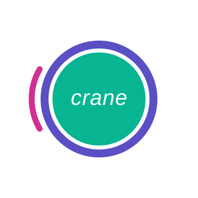

<div align="center">



# 🦅 Crane Programming Language

<p align="center">
  <i>A minimalist scripting language built from scratch in pure C, designed for zero-overhead C integration.</i>
</p>

<p align="center">
  
  
  
</p>

## 💡 Why Crane?

The modern software ecosystem has plenty of heavy, JIT-compiled, and framework-loaded languages. **Crane** takes the opposite approach. 

Crane was born to solve a specific engineering problem: **Bridging the gap between complex C/C++ systems and lightweight scripting, without sacrificing performance or safety.**

- **Zero-Overhead C Integration**: Crane is not just *written* in C; it is designed to *embed* and *call* C directly. It acts as the perfect, lightweight "glue" for your high-performance C engines, game engines, or embedded systems.
- **Minimalist & Intuitive Syntax**: Forget boilerplate. Crane provides a clean, expressive syntax that gets out of your way, letting you write logic faster.
- **Turing Complete & Self-Contained**: Built entirely from scratch (Lexer, Parser, AST, Bytecode, VM) with **zero external dependencies**. No Garbage Collection pauses, no bloated standard libraries—just pure, predictable execution.

## 🏗️ Architecture

Crane operates through a classic, single-pass compilation pipeline, translating high-level syntax directly into highly optimized bytecode.

```text
Source Code (.ce) 
  ↓ [Lexer] 
Token Stream 
  ↓ [Parser] 
Abstract Syntax Tree (AST) 
  ↓ [Code Generator] 
Bytecode + Constant Pool 
  ↓ [Virtual Machine] 
Execution Result
```

### 🚀 Quick Start
Write your first Crane program in hello.ce. Notice how clean the syntax is:
```c
-- Clean variable declarations and arithmetic
int a = 3 * 2;
int b = 9 * 2 + 8;

-- Native C-style function calls
print("hello crane!!", 13, a);
print(b);

-- Short-circuit logic, compiled directly to JMP instructions
if (a > 5 and b < 30) {
    print("Logic works perfectly!");
}
```
Compile and run the VM:

```bash
gcc cranegram/*.c tool/*/*.c -o main.exe
./main.exe hello.ce
```
### ⚙️ Language Syntax (Current Implementation)
Crane's syntax is designed to be immediately readable to anyone coming from C, JS, or Python.

### 1. Variables & Types
Explicit typing ensures predictable memory behavior when interfacing with C.

```c
int a = 10;
string name = "Crane";
```

### 2. Expressions & Precedence
Full support for standard arithmetic operators with strict operator precedence and parentheses.

```c
int result = (10 + 20) * 3 - 4 / 2;
```

### 3. Conditional Statements (if)
Crane supports highly optimized if statements. Under the hood, conditions are evaluated using short-circuit evaluation, generating JMP_TRUE and JMP_FALSE bytecodes.

```c
if (a > 10 and b eq 20 or c < 5) {
    print("Condition met!");
}
```

### 4. Loops (while)
Crane compiles loop logic into backward PC jumps, ensuring zero-overhead iteration.

```c
int i = 0;
while (i < 10) {
    print("Loop iteration:", i);
    i = i + 1;
}
```
### 🔗 Roadmap: The Ultimate C Bridge
Crane's primary goal is to become the ultimate embeddable script for C applications. The upcoming core features focus on C-FFI (Foreign Function Interface):

☑ Arithmetic expressions and variable assignment
☑ Control flow (if / else with short-circuit logic)
☑ Loops (while)
□ C-FFI: Directly import and call C functions (.so / .dll)
□ C-FFI: Pass and receive pointers/structs seamlessly
□ Function definitions and Call Stack (function)
□ Memory Arena & custom Garbage Collection
