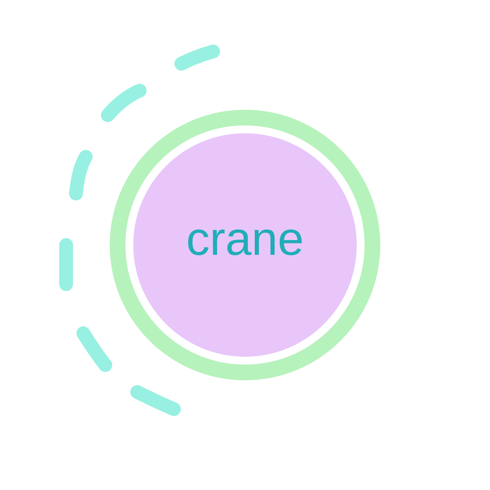

<div align="center">



  <h1>Crane</h1>
  

  <p><b>A lightweight programming language and stack-based Virtual Machine written from scratch in pure C.</b></p>
  
  <p>
    
    
    
    
  </p>
</div>

---

**Crane** is a self-contained, lightweight scripting language implementation built entirely from scratch in pure C. 

Unlike modern languages that heavily rely on third-party infrastructure like LLVM or parser generators like Lex/Yacc, Crane provides a complete, end-to-end view of how programming languages actually work under the hood. From raw source code to lexical analysis, recursive descent parsing, Abstract Syntax Tree (AST), bytecode generation, and final execution in a stack-based Virtual Machine—**everything is hand-crafted**.

## ✨ Core Features

- 🛠️ **Hand-written Frontend**: A custom Lexer and a robust Recursive Descent Parser.
- 🏷️ **Tagged Union Value System**: Native support for multiple data types (`int`, `float`, `string`, etc.) using a `Tagged Union` architecture, ensuring runtime type safety.
- 📦 **Constant Pool Architecture**: Decouples instruction streams (Codes) from actual data. Real values are stored in a constant pool, keeping the bytecode array extremely compact.
- ⚙️ **Stack-based Virtual Machine**: A high-performance VM core driven by a `while` + `switch` dispatch loop, featuring an operand stack and local variable slots.
- 🚀 **Zero Dependencies**: Extremely lightweight. Only requires a standard C compiler to build.

## 🏗️ Architecture

```text
Source Code (.cr) 
  ↓ [Lexer]
Token Stream 
  ↓ [Parser]
Abstract Syntax Tree (AST) 
  ↓ [Code Generator]
Bytecode + Constant Pool 
  ↓ [Virtual Machine]
Execution Result
```

## Write some code
```cr
int a = 3 * 2;
int b = 9 * 2 + 8;
int c = 6 + 1 * 2;
int d = 7 - 1 + 2 * 2 / 2;

print("hello crane!!", 13, a);
print(b);
```

## Expected Output
```text
   ___ ___    _   _  _ ___ 
  / __| _ \  /_\ | \| | __|
 | (__|   / / _ \| .` | _| 
  \___|_|_\/_/ \_\_|\_|___|

Crane Compiler & VM
Version: 1.0.0
Build:   Oct 22 2026 11:08:28
Author:  Xokcal
Platform: Windows x86_64 (GCC)

Welcome to Crane interactive terminal.
Type your code to execute, or input 'h' for help, 'q' to quit.

result a = 6
result b = 26
hello crane!! 13 6 
```